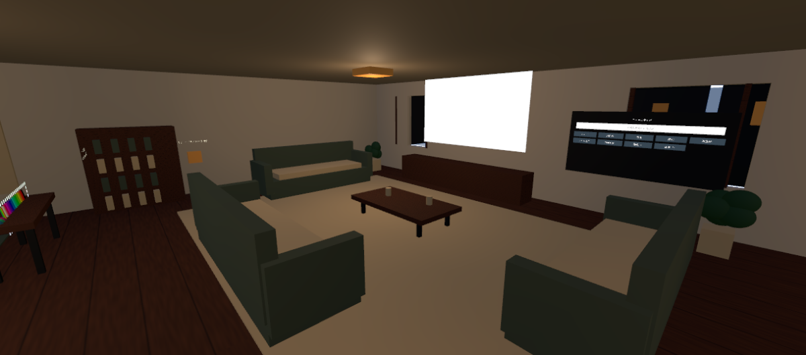
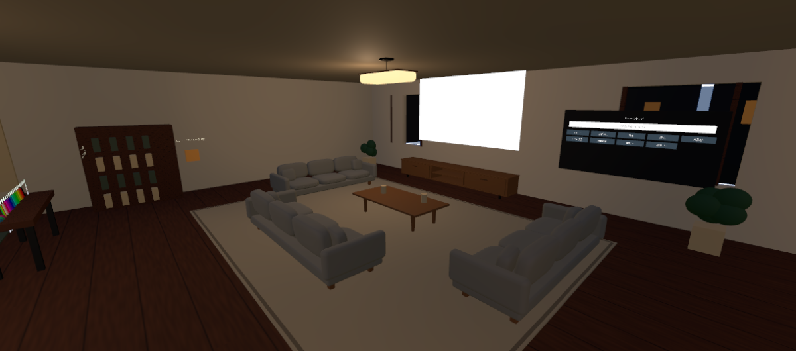

# リビング家具仕上げ記録（2026-10-27 JST）

ALCOM管理の `NightHome`、`Assets/NightHome/NightHome_Blockout.unity` を変更しました。寝室・個室の家具の本仕上げは次の段階です。

## 変更前と保存先

- 開始時コミット：`5304746cb5650250d0ef377d5af7adead8c6dc07`（main）。
- ローカルバックアップ：`Backups/LivingFinish_20261027_122715`。シーン、QualitySettings、変更前のUdon参照一覧、開始コミットを保存。バックアップはGit対象外です。
- Blender MCP：Blender 5.2.3 LTSへ接続。アドオン1.8、protocol 14（サーバー期待15）の更新通知あり。実際のPython実行・FBX出力・blend保存は成功しています。外部生成サービスは使っていません。
- Unity MCP：`NightHome@d24f85dbaee5e64c`、Unity 2022.3.22f1。正式プロジェクトパスは `C:/Users/user/AppData/Local/VRChatCreatorCompanion/VRChatProjects/NightHome`。
- 編集用：`SourceAssets/LivingFurniture/LivingFurniture.blend`、`make_furniture.py`、`mesh_stats.json`。
- Unity用：`Assets/NightHome/LivingFinish` の Models / Materials / Textures / Prefabs。

## 比較画像

以下の2枚はカメラ位置 `(0.8, 2.5, -0.4)`、注視点 `(-4, 1, 4)`、同じ照明・壁材・レンズで撮影しました。家具の元オブジェクトだけを一時的に表示して比較しています。Beforeも壁材は仕上げ後の状態です。

| 旧家具 | FBX家具 |
|---|---|
|  |  |

`01_Before.png` / `02_Detail_Before.png` は制作開始前の記録で、照明・壁材も当初の状態です。最終状態との照明一致比較には上表を使ってください。

家具単体は `Sofa` / `Table` / `Console` / `Rug` の各 `_Front.png`、`_Side.png`、`_Angle.png`。比較用の一時ステージで同じ背景・照明を使い撮影し、ステージは本番シーンから削除しています。

## 家具・素材・配置

- グレー布ソファ：幅3.20mを1台、3.00mを2台。奥行1.04m、モデル高約0.883m。座面・傾斜8度の背もたれ・構造を持つ肘掛け・置きクッション・脚を別部品で制作しました。座面に約11mmの中央たわみ、顔全体に緩やかなふくらみ、座面周囲に直径3.2mmのパイピングを追加。細かいしわは増やしていません。
- ローテーブル：2.10 × 1.05m、家具単体高0.46m。実際のベベルを持つ木製天板、先細りの脚、接合ブロック、幕板。
- テレビ台：幅4.125m、奥行約0.650m、高さ約0.643m。天板・底板・側板・中央棚・扉・金属脚と取手。正面がリビングを向くよう180度回転しました。
- ラグ：7.4 × 5.5m。薄い本体と縁、最大約27mm。大量の毛のメッシュは使わず、布テクスチャと弱いノーマルで表現。
- 暖色のペンダント照明と白ベージュのリビング壁。テレビ・パネルは既存の位置を維持。
- ソファとテーブルの原点高を0.029mにして、脚をラグ上面へ合わせました。マグの底も天板へ追従。テレビ台は床上。
- 木・布・金属を共有マテリアルで分け、木目は部品の長手方向へUVを割り当てています。UVはメートル基準、木目1mタイル、布25cmタイル（織目は約2mm）。Normal MapはUnity側でノーマルとしてインポート。
- テクスチャは自作512px PNG（木目、布、布ノーマル）。外部画像や有料アセットは使っていません。プロシージャルノードに依存せず、Unity Standardの画像マテリアルで表示します。

## Blender → FBX → Unity

blend内の `Source_` コレクションには別部品とベベル・法線モディファイアを残しています。編集用部品は重ならないよう横へ並べ、`Export_` コレクションは原点基準の適用済みコピーとして非表示にしています。

FBXは家具メッシュだけを選択出力。カメラ・ライト・参照オブジェクト・アニメーションは含みません。単位m、FBX Scale All、軸変換の適用を使用し、Unityでスケール1・回転0・実寸を確認しました。Unityでは各FBXのメッシュを使うPrefabを作成し、簡単なBoxColliderと配置用座面マーカーを保持しています。旧Unityメッシュ中間ファイルは参照がないことを確認して削除しました。

旧ブロックアウト家具は `LIVING - Original blockout (disabled)` 内へ退避し、非アクティブにしています。表示もColliderも重複していません。新家具は `LIVING - Finished furniture` 内です。

既存のVRChat着座Stationは0個でした。座面マーカーは目安であり、Useで座る機能は今回追加していません。ソファのColliderは座面付近を残した単純構成で、実際のVR着座姿勢は未確認です。

## メッシュ・負荷

| モデル | 1個あたり三角形 | マテリアルスロット | 配置数 |
|---|---:|---:|---:|
| Sofa320 | 11,396 | 3 | 1 |
| Sofa300 | 11,396 | 3 | 2 |
| CoffeeTable210 | 2,308 | 1 | 1 |
| TVConsole410 | 3,120 | 2 | 1 |
| Rug740 | 732 | 2 | 1 |
| Pendant120 | 992 | 3 | 1 |

新家具合計41,340三角形、7 MeshRenderer、延べ17マテリアルスロット、共有マテリアル7種類、BoxCollider計18個。ラグ・吊り照明にColliderは付けていません。モデルごとに描画メッシュをまとめ、ライトマップ用UV2も生成しています。これはワールド全体やアバターを含む集計ではありません。実機の描画時間・16人負荷は未計測です。

照明ベイクを試しましたが、Progressive CPU Lightmapperが `Material render job skipped - out of system memory` で失敗しました。現在はリビングの既存2灯を影なしRealtimeへ戻しています。ワールド全体の有効Realtime Lightは7灯、影なしです。追加したベイク用Area Lightは無効、Baked GIもOFF。未使用の光源が暗さの原因にならないよう戻しています。Lightmap設定と40点のLight Probeは今後の再調整用として残しています。ベイクによる最適化は未完了です。

## 確認結果

- C#コンパイルエラーなし。既存 `NewsProbeBuilder` のobsolete警告は残ります。
- SDK Builder事前検証：`NoGuiErrorsOrIssues() = true`。
- 今回のFBX家具入りシーン：SDK `BuildAndTest()` が正常終了。ローカルビルド・クライアント起動要求まで成功。VRChatへアップロードしていません。
- ビルド中の既存SDK UI例外（`CreateContentInfoGUI`、SDK Worlds 3.10.5の1364行目）は再発。ビルド自体は成功しましたが、恒久対処は未完了。SDKソースは変更していません。
- Udon Behaviour 114個。変更前後のGlobalObjectId、ProgramSource、公開オブジェクト参照を比較し完全一致。欠落スクリプト0。テレビ、QvPen、入退室ログ・音、個室音声制御、ローカルミラーのコンポーネント参照を保持。
- 寸法・向き・原点・法線・UV0/UV2・素材割当を確認。単体画像で輪郭を確認し、パイピングの位置とテレビ台の向きを修正。
- 主な新家具はx=-7.62～-0.38mに収まり、東側の通路とテレビ操作パネル前を確保。家具ColliderはUnity内で確認しましたが、プレイヤーによる引っかかりや全員からのテレビの見やすさは実機で追加確認が必要です。

以前のビルドでニュース映像をホーム内で確認した記録は引き継ぎます。今回の家具変更後のクライアント表示・移動・映像再生は目視未確認です。音声の実聴、VR操作、QvPen描画、複数人同期、途中参加・所有権移譲、16人負荷も未確認。ニュースURLの外部自動取得とSDK例外の恒久対処は未完成です。

## 利用者側で行う確認

1. ALCOMのNightHomeからUnityを開き、Project欄で `Assets > NightHome > NightHome_Blockout` をダブルクリックします。
2. 上部メニュー `VRChat SDK > Show Control Panel`、`Builder` タブの **Build & Test** を押します。Uploadは使いません。
3. PC版VRChatで、入口→リビング→テレビ操作パネル→寝室・個室を歩き、ソファ脇・ラグの縁・テーブル脚で引っかからないか確認します。ソファにUse着座機能はありません。
4. ソファ付近から字幕とパネルを読み、テレビの音量・消音・停止・再接続を確認します。QvPenの描画・返却、個室出入り後の音、ミラーの本人だけのON/OFFも確認します。
5. VRと複数人の試験は別途必要です。特に音声分離は完全なプライバシーを保証しません。

家具を編集する場合はBlenderの `File > Open` から上記blendを開き、Outlinerの `Source_` を展開します。再生成スクリプトは現在のBlenderシーン内を作り直すため、別の作業ファイルを開いた状態では実行しないでください。FBXを再生成した後、Unity上部 `Night Home > Living Finish > 3 Import FBX and update prefabs` で取り込みを更新します。必要に応じて同メニューの `Use realtime lighting fallback` を使います。

ファイル最大はblend約0.56MBで、FBX・PNGも1個1MB未満。今回はGit LFSを使っていません。`.blend1` 等の自動バックアップ、Unity生成物、認証情報、ニュース映像そのものは保存対象外です。
