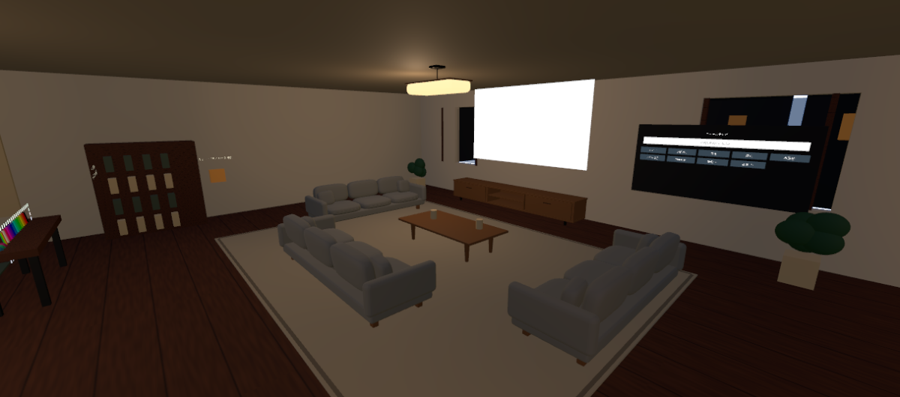
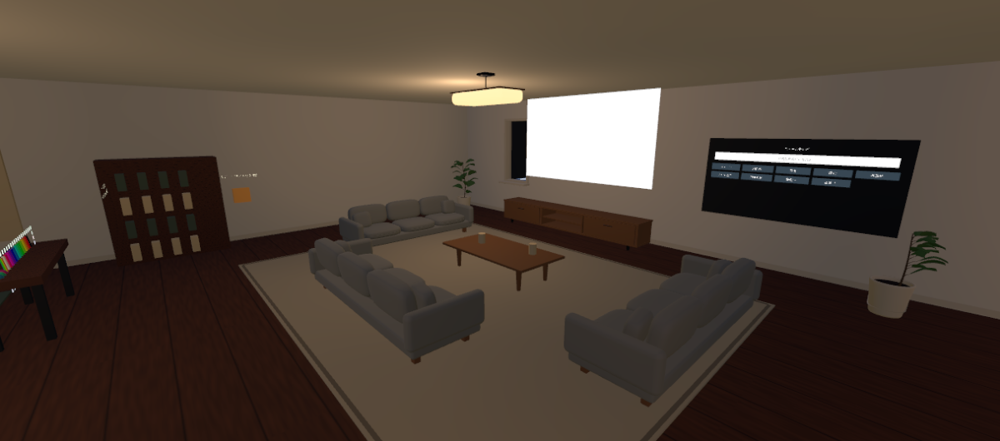
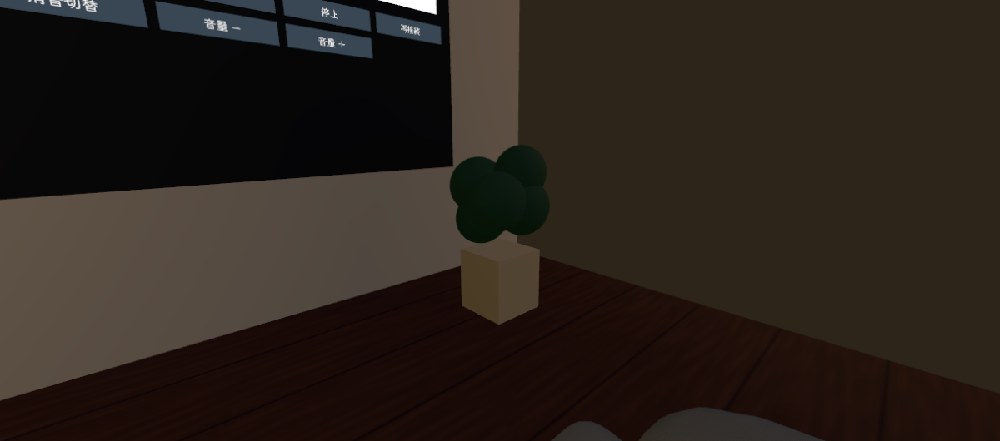
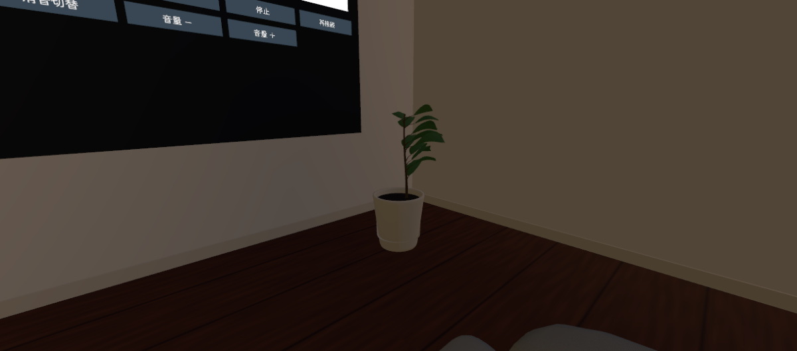
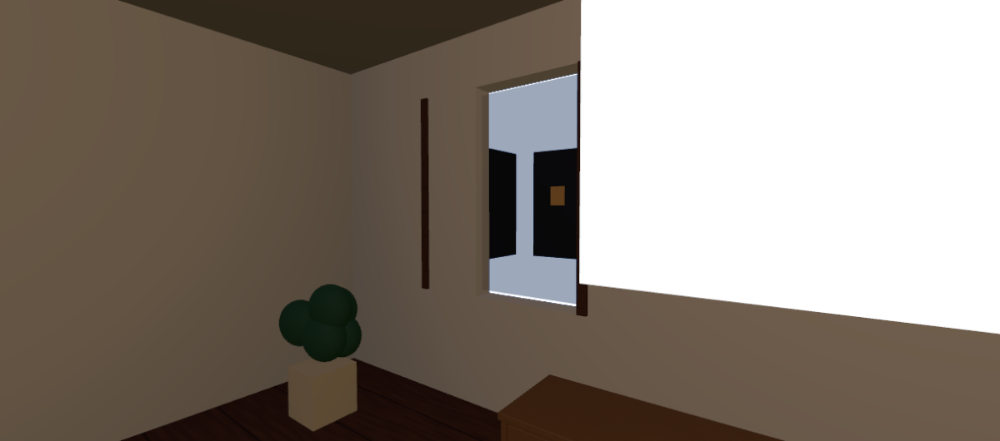
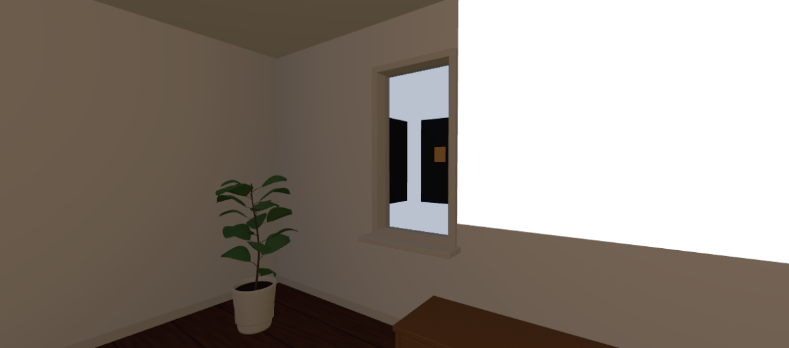
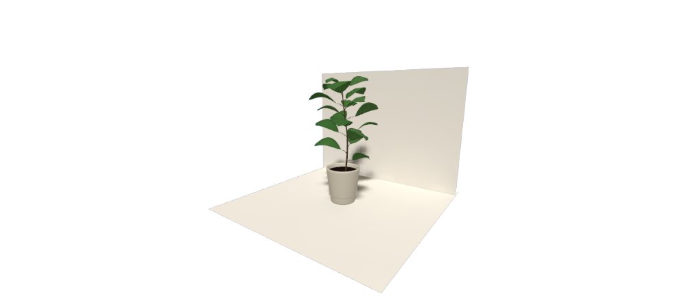
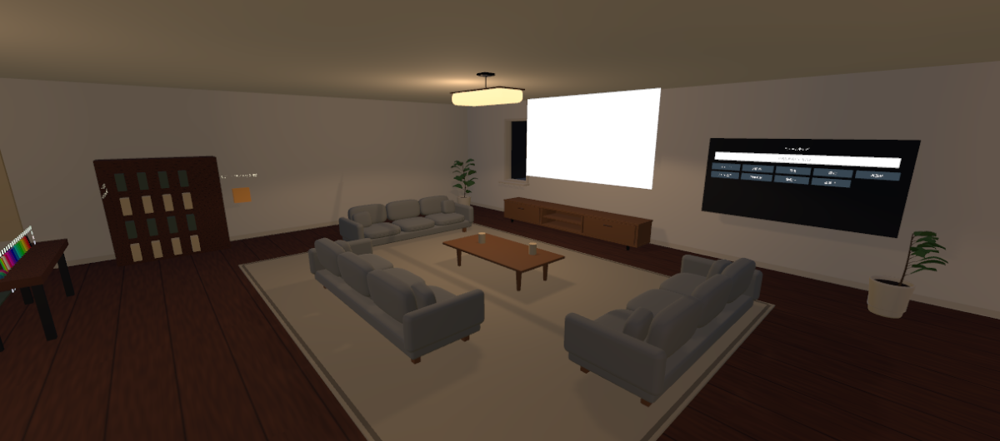
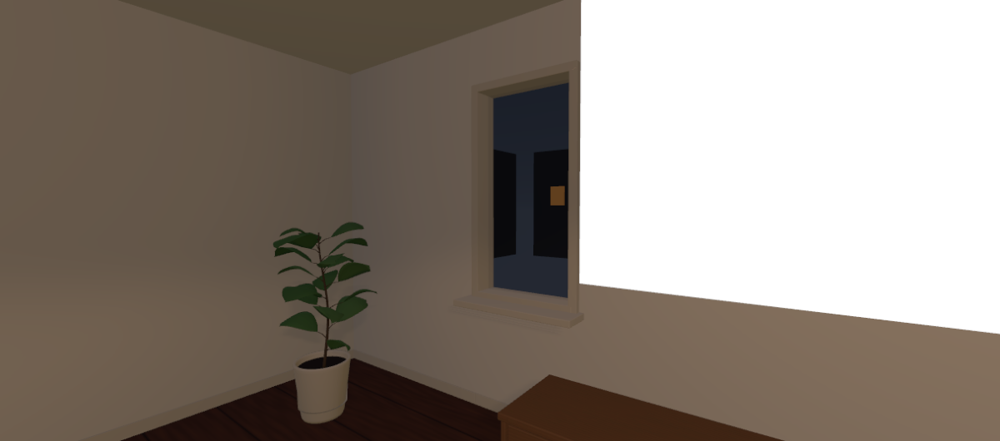

# 観葉植物・壁・建具・陰影の改善（2026-10-27 JST）

制作先はALCOM管理の `C:/Users/user/AppData/Local/VRChatCreatorCompanion/VRChatProjects/NightHome`、制作シーンは `Assets/NightHome/NightHome_Blockout.unity` です。開始時はmainの `cbbe5afb6438380c7e5a87aa61ba816d77eff7a8`、未コミット変更なし。変更前シーンとUdon・Collider一覧を `Backups/PlantsWalls_20261027_130300` に保存しました（ローカルのみ）。

Blender MCP（5.2.3 LTS）とUnity MCP（NightHome、2022.3.22f1）の接続先を確認し、両方で制作・検証しました。Blenderアドオンにはprotocol 14→15の更新通知がありますが、今回のPython実行・FBX出力・blend保存は動作しました。

## 最初の観察と原因

1. 植物は同じ材質の球体5個と箱形の鉢で、幹・枝・葉柄・土がありませんでした。葉のつながりや植物らしい薄い輪郭がなく、浮いた塊に見えていました。
2. 壁は基本的に単色のCubeで、壁紙のUVスケールをそろえる仕組みがなく、巾木もありませんでした。窓枠と入口ドアには古い木目の8倍タイリングが使われ、物理寸法と模様の大きさが対応していませんでした。
3. 北壁の実際の開口は、西が幅1m、操作パネル背面が2m、寝室が5m。それに対してガラスはすべて1.6m、縦枠もその幅で置かれていました。西窓の枠は一部が壁上に取り残され、寝室窓には覆われない隙間がありました。
4. 壁のCube同士には角で重なる面や内部面があり、枠は縦材だけで上下・見込み・窓台がありませんでした。
5. 全体が影なしRealtimeだったため、鉢の接地、壁際、枠の立体感を読み取りにくい状態でした。空のSkyboxもなく、撮影時の窓外は青い背景色になっていました。

## 同じ照明での形状・素材比較

この表はライトの位置・種類・強度・色・影設定とSkyboxを開始時にそろえた比較です。形状・壁材・ガラス材を先に変更し、その後に照明を調整しました。

| 対象 | 変更前 | 形状・素材改善後（照明は同じ） |
|---|---|---|
| リビング全景 |  |  |
| 操作パネル側の植物 |  |  |
| 西窓と壁 |  |  |

カメラ位置／注視点は、全景 `(0.8,2.5,-0.4)` → `(-4,1,4)`、植物 `(-1,1.25,5.1)` → `(0.8,0.65,7)`、西窓 `(-5.8,1.8,5.2)` → `(-7.8,1.7,8)`。各組のレンズ・解像度も共通です。テレビの白い面は編集時の表示で、ニュース映像の実機キャプチャではありません。

## 植物

- 自作の広葉植物をBlenderで制作。土中から出る先細りの幹、枝・葉柄、付け根から続く葉を作り、接続を明示しました。
- 背の高いモデルは18枚、操作パネル側のコンパクトなモデルは13枚。葉幅・長さ・角度・高さ・垂れ・ひねりを固定seedで変え、均等な輪状配置を避けました。コンパクトな株は操作パネルを隠さない方向に葉を伸ばしています。
- 葉には中央の折れと反り、約1.5mmの厚みを持たせました。葉ごとの落ち着いた緑3系統を頂点カラーで分け、自作の控えめな葉脈テクスチャを使用。光沢を抑えています。
- 葉は表裏を備えた閉じた不透明メッシュ。葉の境界に開いた辺がないことをBlenderで確認しました。葉のアルファブレンド・透明ソート・大量の重複した両面板は使っていません。
- 鉢は外面・厚い縁・内面・内底・底面を持つ器にし、土を縁より低い位置へ配置しました。鉢底の12mmの浮きを修正し、床高0mに合わせました。
- 各鉢は元の位置のまま。既存の鉢Colliderを保持し、新しい葉にはColliderを追加していません。
- 背の高い株は約1.68m、コンパクト株は約1.26m。全3鉢の葉頂点について、既存の有効な非Trigger Colliderとの内包判定は0件。操作パネル前の領域に入る葉頂点も0件でした。頂点検査は全三角形の厳密な交差判定や実機の視線試験を代替するものではありません。

## 壁・建具

- 外壁・間仕切り21部材の領域をBlenderで統合して、内部の重複面がない1つの描画用WallShellへ変更。既存オブジェクトはRendererだけを無効化し、Collider・Transform・参照はそのまま保持しています。統合WallShellは閉じたメッシュで、非多様体辺0を確認しました。
- 壁紙は白から薄いベージュの自作512px画像。メートル基準の連続UVに25cmタイルを適用し、細かい模様を低コントラストにしました。凹凸マップなし、低いSmoothnessで、壁ごとの伸びや強い反復を抑えています。天井は近い色のつや消し単色です。
- 室内側の壁下端へ高さ10cm・出幅16mmの巾木を追加。入口ドア下は横断させていません。
- 西窓は実際の幅1m、寝室窓は5mに枠・上下材・ガラスを合わせました。5m窓には方立を2本追加。見込み24cmの枠と奥行34cmの窓台、控えめなベベルで厚みを表現しました。
- 操作パネル背面の中途半端な窓を閉じて、壁にしました。外壁の閉塞部分にだけ2 × 1.9 × 0.2mのBoxColliderを1個追加。通路を塞ぐ追加Colliderはありません。
- 入口、寝室、個室、リビングと廊下の開口に厚みのある枠を追加。既存の通路と個室音声境界を維持しています。入口の既存ドアは形状・Colliderを保持し、縦方向の木目が実寸に合うUVに直しました。
- 初回FBX取り込みで建築の左右反転を見つけ、書き出しメッシュ側の変換と法線を修正しました。Unity側はスケール1、回転0を維持しています。

## 小規模ベイクと最終照明

前回分かっていた失敗は `Material render job skipped - out of system memory` です。今回調べた開始時のGI対象は150 Renderer、バウンディングボックス表面積の合計概算3,344m²、設定12 texels/m、OSの空き物理メモリは約5.6GBでした。概算は正確な実表面積ではなく、特定のオブジェクトやメモリ割り当てが根本原因だと断定する証拠はありません。全体ベイクの再試行はしていません。

別の `Assets/NightHome/PlantsWalls/LightingTrial/ContactProbe.unity` だけを読み込み、ホームをアンロードして試験しました。2.5m四方、植物1鉢と床・壁の3 Renderer、Progressive CPU、最大256px、Direct 8 / Indirect 16 / Environment 8 samplesです。

初回4 texels/mでは32pxのライトマップとUV重複警告が出ました。16 texels/mへ上げ、植物は影を焼き込みつつLight Probeで受光させ、試験面を明示的な単一UV島にしたところ、新しいUV重複警告なしで128 × 128のライトマップが生成されました。鉢底の最終修正後も同じ試験シーンを再ベイクして確認しています。最終試験画像：

この試験用ライトマップはホームに流用していません。ホームのBaked GIはOFFのままです。今後ホームをベイクする際も、部屋ごとに受光対象・影だけの対象・UV余白を検証する必要があります。

ホームは元の7灯の影設定を変えず、Defaultレイヤーだけを対象とするSpot Lightを1灯追加しました。影は512px固定・Soft・強度0.60、範囲11m、角度150度。アバターのレイヤーは除外しています。近い既存Point Lightを1.6から1.25へ下げて、過剰な明るさを抑えました。現在の有効Realtimeは計8灯、影付きは1灯です。全ライトの影を一括で有効にしていません。

窓外には低負荷の自作夜空ShaderとMaterialを設定し、青い背景から静かな暗い夜色へ調整しました。字幕用画面と操作UIを暗くしすぎず、枠やテーブル・壁際に陰影が出ることをUnity画像で確認しました。実ニュース字幕の読みやすさ、HMDでの見え方、GPU時間と16人時の負荷は未確認です。

| 最終全景 | 最終の窓・壁 |
|---|---|
|  |  |

近景：[操作パネル側の株](24_Plant_Final.png)、[背の高い株](26_TallPlant_Final.png)。この最終画像群は照明調整後なので、形状だけの比較には上の同条件表を使用してください。

## 保存物と負荷

`SourceAssets/PlantsWalls` に編集可能な `PlantsWalls.blend`、`make_plants_walls.py`、壁レイアウトJSON、三角形数JSONを保存しました。blend内の `Source_` は編集用の別部品・モディファイアを残したもの、`Export_` は変換を適用して結合した書き出し用コピーです。通常は高い植物のSourceだけを表示します。スクリプトは開いているBlender内のデータを作り直すため、他の作業ファイルで実行しないでください。

`Assets/NightHome/PlantsWalls` にFBX4種、画像3枚、マテリアル、葉・夜空のShader、Prefab5個、入口ドア用UV修正Mesh、小規模LightingTrialを保存。家具・機能用アセットは置換していません。

| 新しい描画モデル | 1個あたり三角形 | Material slots | 配置数 |
|---|---:|---:|---:|
| 背の高い植物 | 5,590 | 4 | 2 |
| コンパクト植物 | 4,320 | 4 | 1 |
| WallShell | 290 | 1 | 1 |
| 建具・巾木 | 15,336 | 1 | 1 |

新しい5 Rendererで計31,126三角形、延べ14 Material slots。植物の4マテリアルは各鉢で共有しています。UV0/UV2、頂点カラー、原点・寸法・向き・法線と表裏を確認しました。モデル自体の集計であり、ワールド全体・アバター・影パスを含む描画負荷の測定ではありません。新規ファイルはすべて100MBを大きく下回るためGit LFSは追加していません。

## 検証結果と未確認

- C#コンパイルとShaderのコンパイルにエラーなし。既存 `NewsProbeBuilder` のobsolete警告は残ります。
- Udon Behaviour 114個と公開オブジェクト参照が変更前後で一致。欠落スクリプト0。
- 既存Collider 189個がシリアライズ設定・位置・回転・拡大率・有効状態まで一致。新しい外壁閉塞Colliderが1個で、合計190個。
- ニューステレビ、QvPen、入退室ログと音、個室音声境界、ローカルミラー、既存家具の参照を保持。旧壁・旧植物のRendererは無効化し、重複表示を防いでいます。
- SDK Builder：ホームで `NoGuiErrorsOrIssues() = true`。今回のホームでローカル `BuildAndTest()` 正常終了。ローカル書き出しとクライアント起動要求まで確認しました。VRChatへのアップロードなし。
- ローカル試験後にSDKが所有していない既存Blueprint IDを解除しました。最終保存の差分はこのIDの空欄化だけで、シーンへ保存しています。終盤にUnity MCPのWebSocket通信が切れたため、対象のUnityウィンドウを確認して通常のCtrl+Sで保存し、未保存マークが消えたこととGit差分を確認しました。
- ベイク試験シーンにはScene Descriptorを置いていないため、開いていたSDKパネルの `CreateValidationsGUI` でIndexOutOfRangeExceptionが出ました。ホームのBuild後は検証が通っています。今後の試験開始処理はSDKパネルを閉じてから試験シーンを開くようにしています。
- 既存のSDK `CreateContentInfoGUI` のNullReferenceExceptionはBuild中に再発。SDKのソースは変更しておらず、恒久対処は未完了です。
- 新しいホームのクライアント内での外観・移動・映像・音声、VR操作、QvPen描画、複数人同期、途中参加、所有権移譲、16人負荷は未確認です。以前のニュース映像確認の記録と今回の見た目確認を混同していません。
- ニュースURLの外部自動取得も未完成です。個室の音声分離は完全なプライバシーを保証しません。

## 利用者が行う確認

1. ALCOMからNightHomeを開き、UnityのProject欄で `Assets > NightHome > NightHome_Blockout` をダブルクリックします。`LightingTrial` は普段の制作・ビルドには使いません。
2. 上部 `VRChat SDK > Show Control Panel` → `Builder` → **Build & Test**。Uploadは使いません。
3. 植物周辺、窓際、入口・寝室・個室の枠を歩き、引っかかりや見えない壁、頭の接触を確認します。葉にColliderはありません。
4. ソファから実際のニュース字幕と操作ボタンを確認します。HMDでも明るさ・葉の裏・影のちらつきを確認してください。音声、QvPen、ミラー、個室音声分離は以前の検証手順も使用します。
5. 実機で影の負荷が高ければ、Hierarchyの `HOME - Plant and wall finish > Living contact shadow - one spot` を選び、InspectorのLightのチェックを外すと影追加前へ戻せます。全ライトの影を有効にする必要はありません。
6. Unity MCPの再接続が必要な場合は、Unity上部 `Window > MCP for Unity > Toggle MCP Window` の接続欄でHTTPの **Connect** を使います。ボタンがDisconnectなら一度切断してConnectを押します。終了時点ではサーバーの接続一覧にNightHomeが残っている一方、Editorへのpingは応答しない状態でした。接続回復後の再検査は未実施です。

外部モデル・写真・有料素材・画像生成サービスは使っていません。新規メッシュ・模様・Shader・スクリプトは自作です。既存の第三者アセットの条件は `THIRD_PARTY_NOTICES.md` を参照してください。
