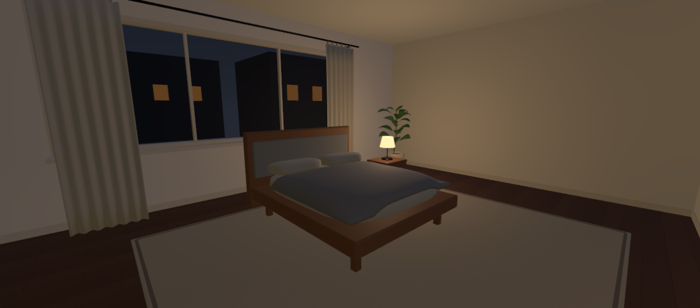
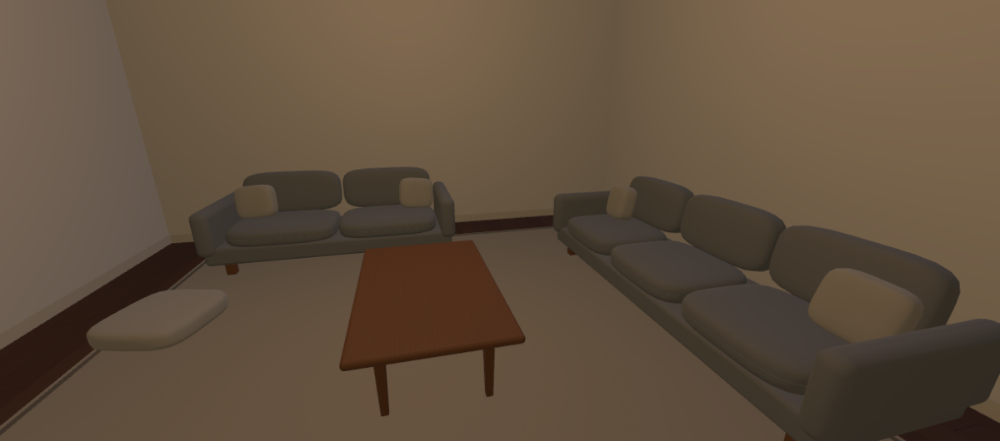
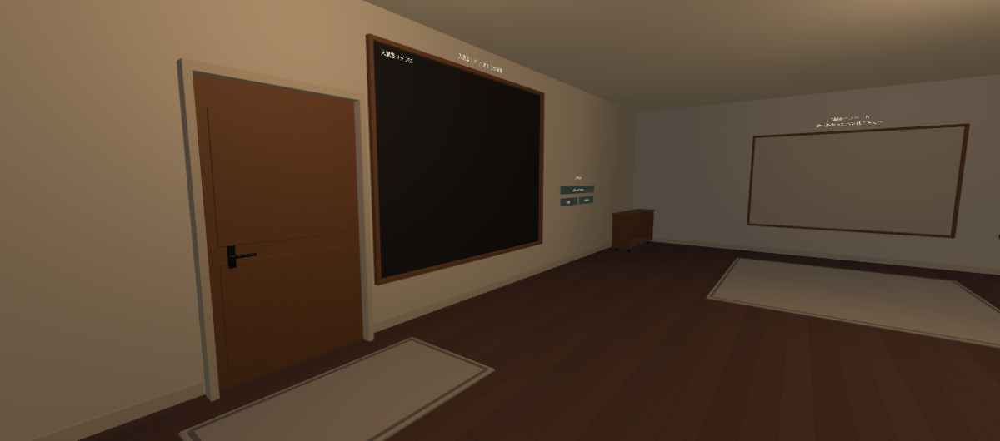
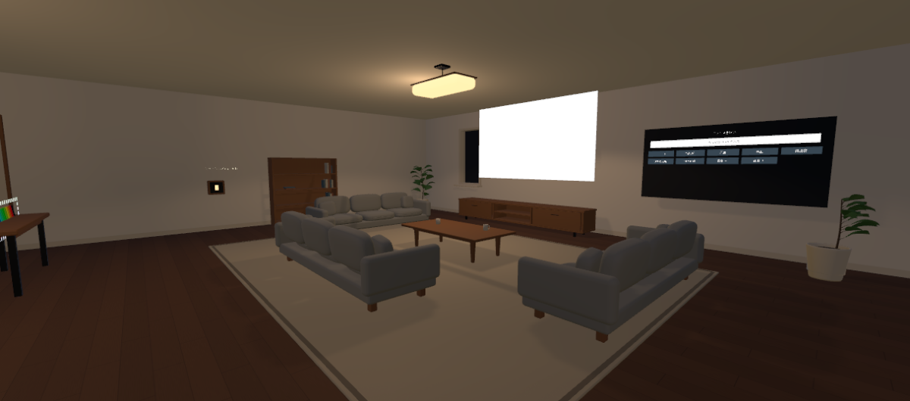
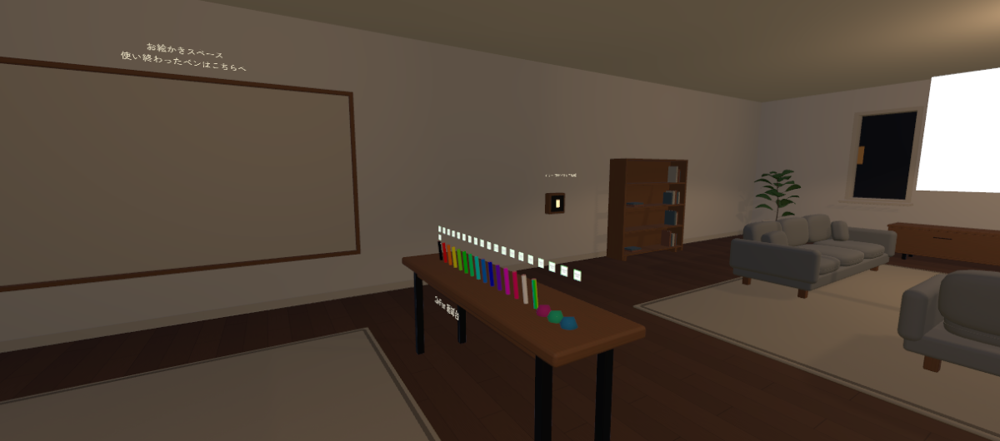
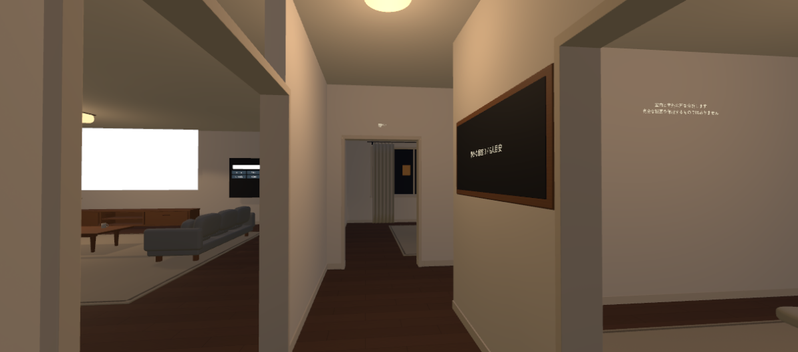

# ホーム全体の家具・内装仕上げ（2026-10-27 JST）

ALCOM管理の `C:/Users/user/AppData/Local/VRChatCreatorCompanion/VRChatProjects/NightHome`、`Assets/NightHome/NightHome_Blockout.unity` を制作対象にしました。開始時のmainは `103eb9e07bc1b98e3c31fc929ada71e203270e7d`、未コミット変更なし。変更前シーンとUdon参照一覧は `Backups/WholeFinish_20261027_140030` に保存しています（バックアップはGit対象外）。

Unity MCPの再接続・Editor操作を確認でき、Blender MCP（5.2.3 LTS）も動作しました。家具の形状はBlenderで制作し、家具メッシュのみをFBXへ出力してUnityへ取り込みました。リビング・植物・壁・建具の完成済みデータを残し、その素材を各部屋へ展開しています。

今回は内装を優先し、ニュースURL自動取得とSDK例外の調査は行っていません。有料素材・外部生成サービスの利用、VRChatへのアップロードもありません。

## 各部屋の画像

いずれもUnity内の画像です。全景は目線高1.65mから撮影しました。寝室の窓外はベッド上の低い目線でも確認しています。PC版VRChatやHMDでのキャプチャではありません。ニュース画面の白い面は編集時の表示です。

| 寝室 | 個室 |
|---|---|
|  |  |

| 入口・廊下側 | リビング |
|---|---|
|  |  |

| 描画・ミラー周辺 | 廊下・個室の人数表示 |
|---|---|
|  |  |

[寝室からの夜景](Final_Bedroom_NightView.png)、[個室内から出口](Final_Quiet_Exit.png)、[マグの近景](10_Mug_Detail.png)も保存しました。

開始時の比較画像は `01_Bedroom_Before.png`、`02_Quiet_Before.png`、`03_Entry_Before.png`、`04_PenMirror_Before.png`。寝室・個室・入口・描画スペースは、開始時と最終画像で同じカメラ位置・注視点を使用しています。最終画像には素材と照明の調整も含むため、形状だけの照明一致比較ではありません。

## 仕上げた内容

### 寝室

- ベッドフレーム、マットレス、枕2個、掛け布団、布張りヘッドボードを自作。マットレスを1.80 × 2.10m、フレーム幅約2.04mに整理し、仮組みの大きなベッドより通路を広げました。
- マットレス・枕には丸みと厚みを付け、掛け布団はマットレスの曲面に沿って膨らみ、縁が垂れるメッシュにしました。最初の確認で見つかった布団の縁の浮きを修正しています。
- 幅62cm・天板高60cmの木製サイドテーブルと、高さ45cmの小さな照明を配置。卓上照明の底と天板を合わせました。
- カーテンは閉じた不透明メッシュで、ひだ・布の吊りタブ・レール・壁へつながるブラケットを作成。裏面が消える問題と窓台を横切る問題を修正し、窓台より手前へ配置しました。開閉機能はありません。
- ベッド・サイドテーブルの脚をラグ上面約2.9cmへ合わせました。主要な移動はベッド足元と左右から可能です。既存の植物と夜景を残しています。

### 個室（ミュートルーム）

- リビングと同系統のグレー布ソファを3人分と2人分、計5座面で配置。床クッション1個、小さな角丸テーブル、縁付きラグで4〜6人の滞在を想定しています。
- 床クッションを入口から奥への経路を避ける位置へ移しました。テーブルとの間や出口側に余白を確保しています。
- 入口上に「個室」、入口脇に人数表示用の木枠パネルを配置。人数を更新する既存のText・Udon参照はそのままに、Canvasの位置だけを変えました。
- 音声境界は位置 `(7,1.6,-3)`、大きさ `(6,3.8,6)`、Triggerのままで変更していません。完全な防音・プライバシーを保証する表現は追加していません。

### 入口・廊下

- 既存ドアのColliderを残し、見た目を厚みと控えめなパネル・金属レバーのある木製ドアへ置換。ドアは従来どおり装飾で、開閉機能はありません。
- 玄関マット、低い木製収納、入退室ログの木枠とJST見出しを追加。ログ本体と入退室音設定の参照は保持しています。
- ドア枠・巾木は前回の仕上げを保持。残っていた四角い天井照明を、天井へ接する薄い丸型のFBX照明器具に置き換えました。
- スポーン位置 `(-1,0.08,-6.1)`、向き342度（-18度）、最大16人設定は変更していません。

### 本棚・小物・操作部

- 本棚を板・棚・背板・脚へ作り分け、本の幅・高さ・奥行・配色を少しずつ変え、立てた本と小さな積み重ねを配置しました。棚を物で埋めていません。
- 本棚は旧ミラー前 `(-9.5,0,-0.2)` 付近から、西壁の `(-9.55,0,3.2)` へ移動。初期OFFのミラー前とスイッチへの見通しを空けました。
- マグを高さ約10.6cm、厚い縁、内側、つながった取っ手、茶色の中身があるメッシュへ変更。底を既存ローテーブルの天板高0.489mへ合わせました。持ち運び機能は従来どおりありません。
- QvPen返却台を角丸の木製天板と金属脚で作り直し、天板上面0.87mを保持。公式QvPen Prefabの位置・参照は変更していません。返却ラベル、描画ボードの枠、同じ素材の描画用ラグも整えました。
- 浮いていた描画スペースの案内を壁面へ移動。ミラースイッチも壁へ寄せ、木製ベゼルとUseボタンの見た目にしました。既存のUdon Behaviour・Use Collider・ローカルミラーへの参照を保持しています。

### 素材・照明の統一

- 木製家具は既存リビングのWalnut、布はGrayFabric・RugWeave等の共有マテリアルを使用。白い寝具は布マテリアルを継承したBedLinenです。木・布・金属の光沢を分けました。
- 床は寸法・Colliderを保持したままメートル基準のUVへ変更。板幅約20cm、長さ1.2mの自作512px木目画像を使い、仮組み時の大きな縞を抑えています。床色は家具に合う落ち着いたウォールナット色です。
- 入口・廊下・個室の既存Point Lightの色を暖色でそろえ、強度差を調整。寝室は既存Point Lightをサイドテーブル側へ移しました。
- 新しいRealtime Lightは0灯、影の追加も0灯。ワールド全体で有効Realtime 8灯・影付きSpot 1灯という前回の構成を維持しています。新しい照明器具は見た目のメッシュで、灯数を増やしていません。
- 全体ベイクは行っていません。ホームのBaked GIはOFFのままです。

## Colliderと着座位置の変更

旧家具は `HOME - Archived remaining blockout (disabled)` に退避しました。オブジェクトを削除せず、旧Collider27個を非アクティブにして重複を防いでいます。新しい家具にはBoxCollider23個を配置しました。複雑な描画メッシュのMeshColliderは使用していません。

| 対象 | 変更理由・内容 |
|---|---|
| ベッド | 実寸へ縮小した新形状に合わせ、支持面とヘッドボードのBox計2個へ置換。枕・掛け布団に個別Colliderは付けていません。 |
| 個室ソファ | 新しい幅3.0m・2.4m、座面高約0.50mへ合わせて本体・背・肘掛けを各4個のBoxで表現。座面マーカーは3個＋2個。 |
| テーブル・返却台 | 天板と脚に簡単なBoxを使用。QvPen天板は上面0.87m、個室テーブルはラグ込み上面約0.509mです。 |
| 本棚・玄関収納・サイドテーブル | 各1個の大まかなBox。引き出しや本を個別の物理オブジェクトにはしていません。 |
| ミラースイッチ | 壁から浮いた見た目を直すため、既存ColliderとUdonを持つルートをX=-9.60mから-9.82mへ22cm移動。Colliderの寸法と参照は保持。新しい装飾にColliderは追加していません。 |
| 既存の床・外壁・入口ドア・個室音声境界 | Colliderの形状・位置を保持。床は見た目のUVとマテリアルだけ変更。 |
| ラグ・カーテン・小物・照明器具 | Colliderなし。低いラグの段差や布の凹凸で移動を妨げない構成です。 |

新しい個室の座面マーカーはラグ込み約0.499mで、リビングの座面にそろえています。旧仮組みの約0.685mから下げたため、ソファのColliderも合わせました。既存リビングのマーカーは保持しています。マーカーは配置用であり、Useで座るStationやベッドへ寝るギミックを今回追加したものではありません。

## 確認結果

- C#コンパイルエラーなし。UdonSharpの同期コンパイルを実行し完了しました。
- Udon Behaviour 114個と、ProgramSource・公開オブジェクト参照の変更前後の一覧が完全一致。欠落スクリプト0。テレビ、QvPen、入退室ログ・音、個室音声制御、ローカルミラーの参照を保持しています。
- 容量16人、スポーン、個室音声境界、ミラー初期OFFを確認。
- 幅44cm相当のカプセルを使い、入口→廊下→寝室、廊下→個室、描画スペース→ミラー脇の経路を10cm間隔で検査。検査点での衝突は0件。これはVRChatのプレイヤー・全アバター寸法・全通路の保証ではありません。
- 既存ミラーUse Colliderへ正面からRaycastできることを確認。実際のUse入力や他人からの見え方は実機未確認です。
- ベッド・カーテン・マグ・個室ソファ・本棚の書き出しメッシュで、開いた辺0・面積ゼロの面0をBlenderで確認。Unityで寸法、原点、回転、素材、UV0/UV2を確認しました。
- Unityで各部屋を撮影し、掛け布団の浮き、カーテンの裏面・窓台との交差、吊り部分、表示板と枠の重なり、通路を修正しました。
- SDK Builderの事前検証 `NoGuiErrorsOrIssues() = true`。最終状態でローカル `BuildAndTest()` が正常終了し、書き出しとクライアント起動要求まで成功。今回の実機確認は行っていません。
- Build中には既存のSDK例外が表示されました。指示に従い、調査やSDKソースの変更はしていません。ニュースURL自動取得の作業も保留です。

細かな集計は [Validation.txt](Validation.txt)、変更前一覧は [BeforeInventory.txt](BeforeInventory.txt)、参照一覧は [UdonRefsAfter.txt](UdonRefsAfter.txt) に保存しています。

## 保存物・負荷

`SourceAssets/WholeFinish` に編集可能な `WholeHomeFurniture.blend`、生成スクリプト `make_whole_home.py`、形状集計JSONを保存。`Assets/NightHome/WholeFinish` に22種類の家具FBX、共有マテリアル、床PNG、Prefab、床UV修正Mesh、各.metaを保存しています。旧家具・旧素材は復旧用に残しています。

今回配置したFBXは27 Renderer、Unity取り込み後58,572三角形、延べ60 Material slots、BoxCollider23個です。共有マテリアルを使っています。これは今回分の集計で、ワールド全体・影パス・アバターの負荷ではありません。作者側の三角形数は `SourceAssets/WholeFinish/mesh_stats.json` にあり、FBX取り込み時の縮退面除去等でUnity側の値と一部差があります。

寝具・カーテン等の布には既存512pxの織目とNormal Mapを再利用し、新規の床画像も512pxです。最大の新規ファイルはblend約1MBで、Git LFSは追加していません。Unity生成物、認証情報、`.blend1` 等の自動バックアップはGit対象外です。

## 残作業・あとでまとめて行うこと

実機の外観、移動・当たり判定、音声、VR入力、QvPen描画、複数人同期、途中参加・所有権移譲、16人負荷は未確認です。全体ベイクも未実施です。ニュースURL自動取得とSDK例外は今回の保留事項として残っています。

部屋を巡る順番の [実機確認チェックリスト](WALKTHROUGH.md) を用意しました。ここに沿ってまとめて試し、問題の部屋・操作・人数を記録してください。内装は一通り仕上げていますが、実機で問題が見つかればその結果に合わせた調整が必要です。
